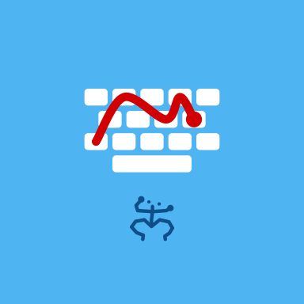

# Bori Keyboard

A free, open-source, fully offline Android keyboard. Made in Puerto Rico. 🇵🇷

- **Glide typing** with its own pure-Kotlin decoder, plus a Swipe Trainer that learns your swipe style
- **Spell correction and prediction** for **English and Spanish**: large dictionaries,
  sentence-aware next-word prediction, autocorrect with one-tap undo, learns your words
- **Emoji panel** with selectable open emoji styles (Twemoji, Blobs, Fluent, OpenMoji, Noto,
  EmojiOne 2, Firefox), and the Puerto Rico flag with its light-blue triangle
- **Clipboard history**, spacebar cursor slide, delete-word slide, key flicks, number row
- **Foldable-aware**: split keyboard on big screens
- Customisable swipe trail (colours, rainbow, thickness), light/dark themes
- **No internet permission.** Nothing you type leaves the phone.

## Building
A normal Android Gradle project (Kotlin, Compose for Settings, Views for the keyboard).
Developed and built on the phone with Bori - Code. Dictionary and emoji tooling is in `tools/`
(see `tools/README.md`).

## License
GPL-3.0-or-later (see `LICENSE`). Word lists, dictionaries and emoji art come from open
projects under their own licenses; see `ATTRIBUTION.md`.
